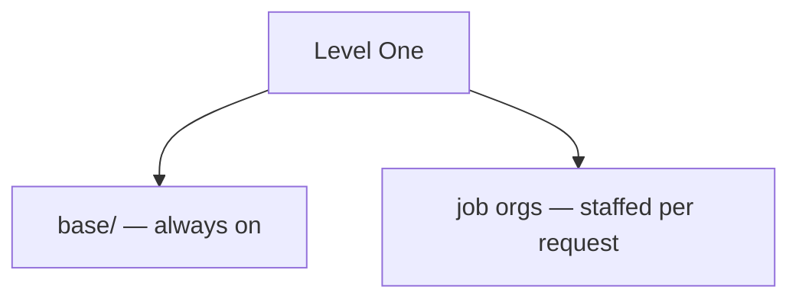
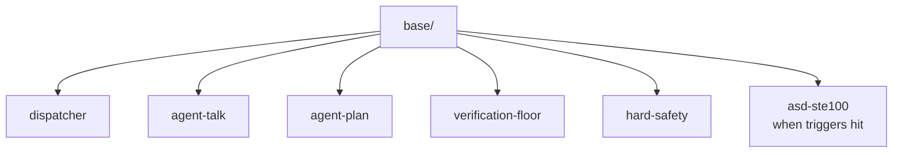
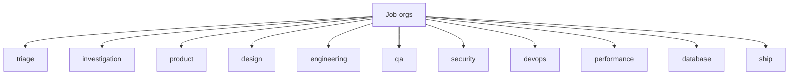

# Level One Skills

A **domain-generic agentic skills pack** for Cursor (and compatible agents). Import it into a project so the agent behaves like a small company: standing **base** policy at HQ, a **dispatcher** that staffs department orgs every request, and one folder per job org.

## Organization chart

Split into two diagrams so each stays readable (one giant Mermaid board shrinks in GitHub/IDE previews).

### How the company fits together



The `dispatcher` skill in `base/` decides which job orgs to staff for each request (no cross-link drawn here so the layout stays clean).
### HQ — `base/` (always on)



### Job orgs — staffed per request

Each node is `.agents/skills/<name>/SKILL.md`.



| Layer | Path | Binding |
|---|---|---|
| **Base (HQ)** | `.agents/skills/base/<skill>/` | Always-on Cursor rule + skill bodies |
| **Writing floor** | `.agents/skills/base/asd-ste100/` | Same rule; apply when its triggers hit |
| **Job orgs** | `.agents/skills/<org>/SKILL.md` | Dispatcher staffs and **reads** each org’s skill; Cursor auto-match with justification also staffs |

Dispatcher runs on **every** request. When unsure which org to staff, it leans inclusive (missing the right role is worse than an extra one).

Cursor discovers nested skills recursively — category folders are organizational only; each skill’s identity is the folder that contains `SKILL.md`.

## Install

### 1. Skills (Skills CLI)

From the consuming project root:

```bash
npx skills add rygillette/level_one_skills
```

Skills land under `.agents/skills/` (where Cursor discovers them).

Update later with `npx skills update`.

### 2. Always-on rule (**Required**)

Without this rule, Cursor may discover skills but **will not** enforce base policy or “dispatcher every request.” The pack’s core promise does not hold.

**Option A — no clone** (copy the rule file straight from GitHub):

```bash
mkdir -p .cursor/rules
curl -fsSL -o .cursor/rules/level-one-base.mdc \
  https://raw.githubusercontent.com/rygillette/level_one_skills/master/cursor-rules/level-one-base.mdc
```

**Option B — from a checkout of this repo:**

```bash
node scripts/install-rule.mjs /path/to/consuming-repo
```

**After every `npx skills update`:** re-run Option A or B so the rule does not drift behind skill updates.

**Verify:**

```bash
test -f .cursor/rules/level-one-base.mdc && echo "rule ok"
```

Optional escape hatch (not the primary staffing model):

```bash
npx skills add rygillette/level_one_skills --skill engineering
```

## Layout

```text
.agents/skills/
  base/                      # HQ — standing policy
    dispatcher/
    agent-talk/
    agent-plan/
    asd-ste100/
    verification-floor/
    hard-safety/
  triage/                    # job orgs (one department each)
  investigation/
  product/
  design/
  engineering/
  qa/
  security/
  devops/
  performance/
  database/
  ship/
cursor-rules/level-one-base.mdc
scripts/validate-pack.mjs
scripts/install-rule.mjs
```

## Contributors

```bash
npm run validate
```

Manual staffing spot-checks: [docs/staffing-scenarios.md](docs/staffing-scenarios.md)

## License

See [LICENSE](LICENSE). Individual skills may carry additional notices (e.g. `asd-ste100`).
